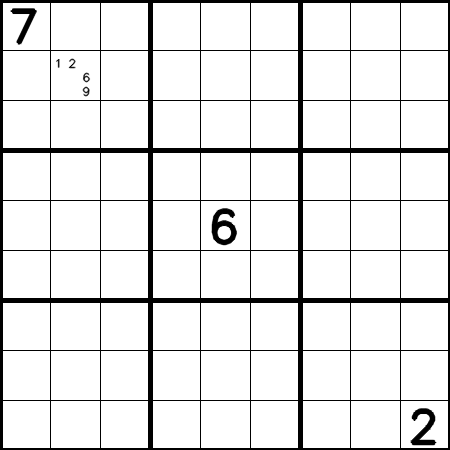
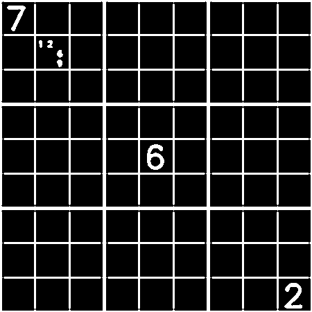
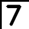

# Pseudoku

A browser-based Sudoku parser, logical hint engine, and puzzle workspace. Import
a puzzle from an image, work through it with notes and colors, and ask for an
explained next step when you get stuck.

**[Play Pseudoku →](https://pseudoku.duckdns.org)**

## General description

Pseudoku brings puzzle entry, image recognition, and guided solving into one
workspace. Choose a puzzle from eight difficulty levels, paste a puzzle string,
or import a photo or screenshot of a Sudoku grid. The hint panel explains logical
deductions and highlights the cells behind each step so you can continue solving.

The app runs entirely in your browser. All puzzle selection, validation, solving,
hints, and image parsing happen on your device. There are no accounts, databases,
app servers, or external runtime services.

Live app: [pseudoku.duckdns.org](https://pseudoku.duckdns.org).

## Tutorial

1. **Load a puzzle.** Choose a difficulty and use Generate, paste an 81-character
   puzzle, enter clues on the board, or import a Sudoku image. Review and correct
   recognized digits before solving.
2. **Work on the board.** Select a cell and enter digits with `1`–`9`. Use corner
   or center notes to track candidates, and color cells to mark patterns.
3. **Ask for a hint.** Read the explanation and highlighted evidence, then apply
   the suggested placement or candidate elimination.
4. **Check your progress.** Use the board check while solving. A correct completed
   grid opens a finish dialog with elapsed time, hints, and checks used.
5. **Continue or share.** Reload to recover your current board locally, or copy a
   self-contained share URL containing the puzzle.

### Controls

| Input | Action |
| --- | --- |
| `1`–`9` | Enter a digit, note, or color in the selected cells |
| `Space`, `Backspace`, `Delete`, or `0` | Clear selected cells |
| Arrow keys or `W` / `A` / `S` / `D` | Move between cells |
| `Shift` + arrow keys | Extend the selection |
| Click and drag | Select multiple cells |
| `Alt` / `Ctrl` + click | Add or remove a cell from the selection |
| `Z` / `X` / `C` / `V` | Select Normal / Corner / Center / Color mode |
| `Enter` | Apply the quick-fill digit to the selection |
| `Ctrl` + `Z` / `Ctrl` + `Y` | Undo / redo |
| `P` | Pause or resume the timer |

## Features

- Pick from 78,213 SE-rated puzzles across eight difficulty levels.
- Import a Sudoku image, paste an 81-character puzzle, or enter clues on the board.
- Get logical hints with explanations, highlighted evidence, and candidate eliminations.
- Advanced contradiction and forcing chains supplement the l2sg WebAssembly solver.
- Check the board and detect completed puzzles locally.
- Corner/center notes, color paint, multi-selection, quick fill, auto notes, undo/redo.
- Local timer and finish statistics, including hints and checks used.
- Save the current board and settings in browser storage and restore them on reload.
- Copy a share URL containing the puzzle itself; no sharing service is involved.

## Technology stack

| Component | Technology and purpose |
| --- | --- |
| Interface | Next.js, React, and TypeScript; exported as a static site |
| Logical hints | C++ l2sg solver compiled to WebAssembly, with TypeScript hint helpers |
| Advanced deductions | Local contradiction and forcing chains with independently verified proofs |
| Image import | OpenCV.js grid extraction and ONNX Runtime Web digit classification |
| Digit model | Bundled MNIST ONNX model, executed in a Web Worker |
| Puzzle collection | SE-rated corpus converted to static chunks during the build |
| Persistence | Browser storage for board recovery, settings, and theme |
| Verification | Vitest, Testing Library, and Playwright with Chromium and WebKit |

## Image parsing: a worked example

Uploading, pasting, or dropping an image opens a local crop preview before OCR.
Adjust the suggested rectangle by dragging its corners or entering percentage
boundaries, then choose **Use crop**. Choose **No crop — already cropped** to
use the original image, or cancel to keep the current puzzle.

Crop suggestions reuse the OpenCV grid detector in a browser worker. Detection
uses a grayscale preview capped at 1400 pixels on its longest side, Gaussian
blur, adaptive thresholding, and convex four-corner contours. It checks the
largest 24 contours, including outlines nested inside other panels, down to 1%
of image area. Each candidate is warped to a square and must contain at least
six of the eight expected inner grid lines in each direction, with at least
half of each line present. The first passing candidate supplies a crop with a
small border margin. If none passes, the user can crop manually or skip cropping.
The crop is exported at original image resolution; detection and digit
classification stay on the device. After the user confirms the image is cropped,
OCR can use its edges as the grid bounds if the outer border is incomplete.

This example follows the real image-import pipeline using the Sudoku image below.
It contains three large digits and a group of small pencil notes. The cell at
**row 1, column 1** contains a **7**; the following images show its journey from
source pixels to the MNIST model input. These are actual intermediate outputs
from the parser, not illustrations.

### 1. Find and straighten the grid

| Original image | Grayscale | Gaussian blur |
| --- | --- | --- |
|  |  |  |

The image becomes grayscale, then a 7×7 Gaussian blur reduces noise for grid
detection. This example starts in black and white, so the grayscale version
looks the same as the original.

| Grid-detection mask | Straightened grid |
| --- | --- |
|  |  |

Adaptive thresholding produces a mask for contour detection. The parser searches
large contours for a four-corner outline, then uses its corners to correct
perspective and map the **original grayscale image** to a 450×450 square.
The grid-detection mask is used to locate the board; digit crops come from the
straightened grayscale image.

### 2. Extract a single cell and separate its ink

| Single cell: 50×50 | Border trimmed: 42×42 | Black-and-white ink mask: 42×42 |
| --- | --- | --- |
|  |  |  |

The grid is split into 81 cells, each 50×50 pixels. Removing four pixels from
each edge leaves a 42×42 interior without the grid borders. Otsu thresholding
separates ink from background; the majority tone becomes black background,
leaving the digit as white ink.

Ink components within **7% of the original cell width** are grouped without
thickening their strokes. A cell is accepted only when its ink forms one cluster
and its longest dimension reaches **50% of the original cell width**. Both sides
must also remain strictly below **90% of the inset crop width**, rejecting border
fragments that could otherwise be classified as a one. This skips
small pencil notes, including those in row 2, column 2 of this example.

### 3. Prepare the MNIST input

| Isolated digit: 26×37 | Resized digit: 14×20 | Final MNIST image: 28×28 |
| --- | --- | --- |
|  |  |  |

The parser crops to the ink bounds, preserves the aspect ratio, and resizes the
digit to fit inside 20×20 pixels. It centers that result on a black 28×28 canvas.
The images above are enlarged for readability; their labels give the actual
pixel dimensions. Resizing the binary ink mask uses area interpolation, so the
final image can contain gray edge pixels as well as black and white.

Pixel intensities are divided by 255 to create values between 0 and 1, then sent
to the bundled MNIST model as a **1×1×28×28** tensor. ONNX Runtime Web performs
classification locally. The recognized board remains editable: review imported
digits before solving. Images stay on your device throughout the process.

## Third-party notices

See [THIRD_PARTY_NOTICES.md](THIRD_PARTY_NOTICES.md) for dependency, model,
solver, and puzzle-corpus attribution. The project itself is MIT licensed.
